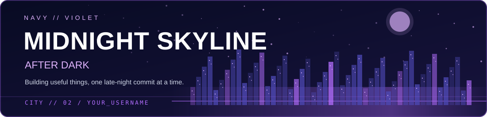
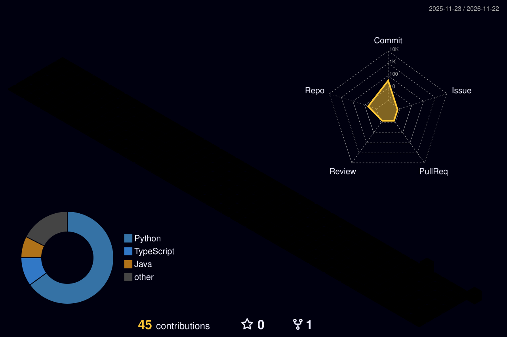
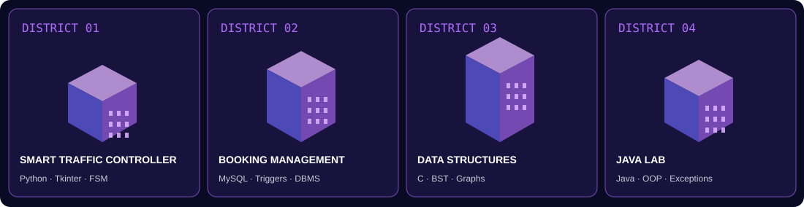

<!-- GitHub profile README for ShutReptile990. -->

  

  <h1>Hi, I'm ShutReptile990 👋</h1>
  
<strong>Developer · Problem Solver · Tech Explorer</strong>

  
Building useful things, one late-night commit at a time.

  
  

 

### About the developer

I'm exploring **software development, data structures, digital electronics, and databases**. I like projects that turn complicated ideas into something visible, useful, and easy to understand.

- 🔭 Building simulations and practical programming projects
- 🧠 Learning more about systems, algorithms, and software design
- 💬 Interested in **Python, C, Java, SQL, and clean interfaces**

 

  
<em>Every block represents real GitHub contribution activity; the image is generated after you run the included GitHub Action.</em>

  
  Auto-generated from GitHub activity by GitHub Profile 3D Contrib.

 

  
  

 

  

<code>Python</code> · <code>C</code> · <code>Java</code> · <code>MySQL</code> · <code>HTML/CSS</code> · <code>JavaScript</code> · <code>Git</code>

 

| Landmark | What it explores | Code |
|:--|:--|:--|
| 🚦 **Smart Traffic Signal Controller** | Traffic-signal FSM, simulated sensors, Python/Tkinter UI | [Add repo link](https://github.com/ShutReptile990) |
| 🗄️ **Booking Management System** | MySQL tables, queries, keys, and triggers | [Add repo link](https://github.com/ShutReptile990) |
| 🌳 **Data Structures in C** | Binary search trees, graph DFS and BFS | [Add repo link](https://github.com/ShutReptile990) |
| ☕ **Java OOP Practice** | Inheritance, abstract classes, exceptions, inner classes | [Add repo link](https://github.com/ShutReptile990) |

Replace the example repository links with your real project links. Remove any project that you don't wish to show.

 

  
  
  
  

    
  MIDNIGHT SKYLINE · Designed for GitHub's Markdown renderer · Powered by actual commits, not invented counters.

